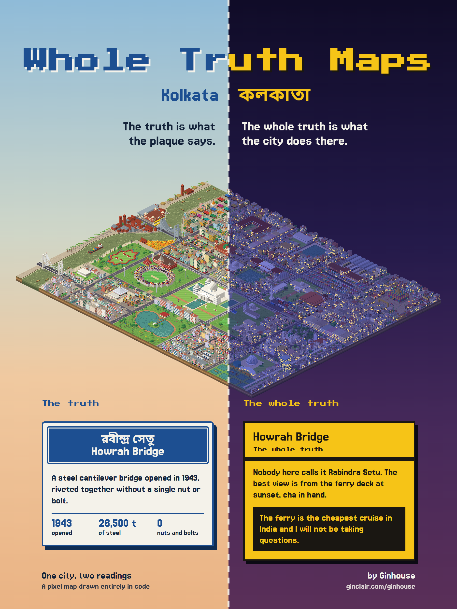
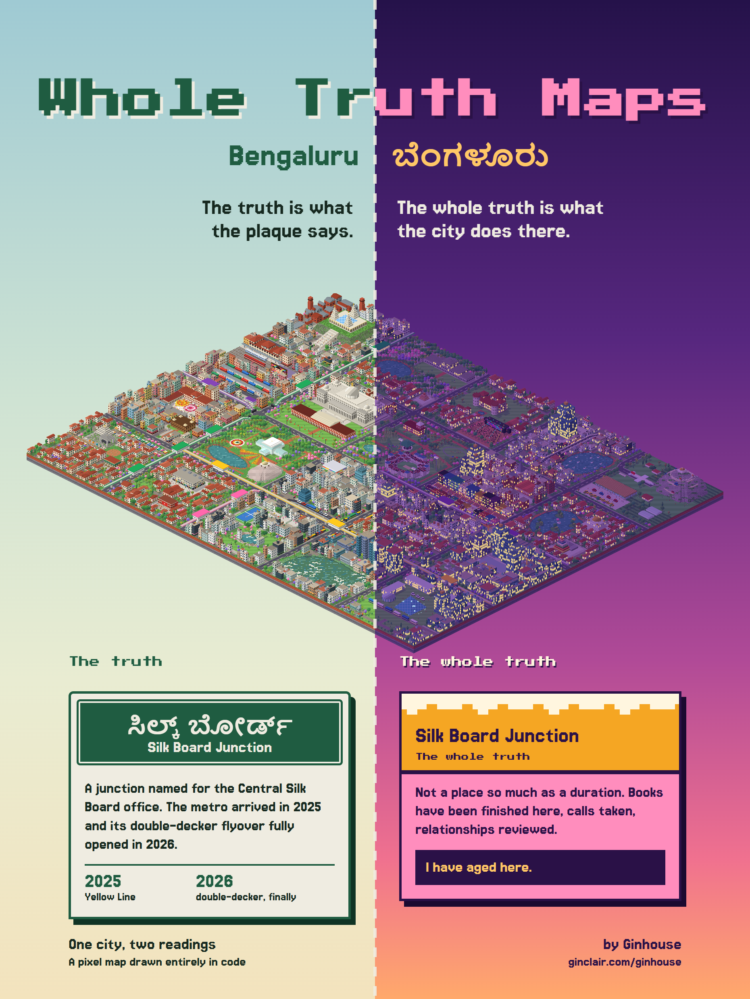

# Whole Truth Maps

By [Ginhouse](https://ginclair.com/ginhouse). Live at [whole-truth-maps.vercel.app](https://whole-truth-maps.vercel.app/).

Maps that tell you the truth about a city, and then the whole truth. Each city is a zoomable isometric pixel-art map, drawn entirely in code. Every place carries two readings:

- **The truth** is the checkable part: dates, names, numbers.
- **The whole truth** is the lived part: what people do there, what is changing, how under-25s talk about it.

One switch flips the whole city from day (truth) to dusk (whole truth), and flips each place card with it. Tabs in the header move between cities and keep the reading you are on.

| | [Kolkata](https://whole-truth-maps.vercel.app/kolkata/) | [Bengaluru](https://whole-truth-maps.vercel.app/bengaluru/) |
|---|---|---|
| The truth | Blue enamel street nameplate | Park-board green on granite, Kannada first |
| The whole truth | Yellow-cab stencil | Tabebuia pink, jacaranda, ale and a foam head |
| |  |  |

## Run it

No build step and no dependencies.

```bash
npm start
```

Then open http://localhost:4173. To deploy, push to the main branch. On Vercel use the "Other" preset with no build command.

## How it is laid out

| Path | What it does |
|---|---|
| `index.html` | Opens the city you were last in, or Kolkata. Passes old shared links along |
| `shared/engine.js` | Software isometric rasteriser: boxes, domes, trees, vehicles, ground, dusk tint |
| `shared/app.js` | Pan and zoom, pins, cards, search, city tabs, share links |
| `shared/style.css` | Interface |
| `<city>/config.js` | Name, language, opening shot and palette |
| `<city>/theme.css` | Interface colours and materials |
| `<city>/layout.js` | Where roads, water and rail are. Shared by the art and the animation |
| `<city>/city.js` | The districts and landmarks |
| `<city>/anim.js` | Everything that moves, and the dusk-only effects |
| `<city>/data.js` | The places and all the copy |

There are no image files in the maps. Each city is drawn on page load into a colour buffer and a depth buffer, which is what lets a tram pass behind a building.

## Edit the copy

All text lives in `<city>/data.js`. Each place has `truth` (a line plus fact chips) and `whole` (a line, a quote, three 1 to 5 meters, tags). Move a pin by changing `at: [i, j]`, the cell on the 120 x 96 grid.

Recent news and the main dates were checked against published sources in November 2026. Some older dates and the Bengali and Kannada spellings were not individually verified, so have someone who knows each city read its file. The whole-truth lines are opinion and will date quickly.

## Change the art

```bash
node tools/render.js bengaluru
```

This writes day and night images to `tools/out`. Add `x y w h scale` for a zoomed crop. Poster and share-image sources are `tools/poster-<city>.html` and `tools/og.html`.

## Add a city

Copy a city folder, change its files, add its tab to each city's `index.html`, its colours to `.city-tab` in `shared/style.css`, and its id to the root `index.html`, `tools/render.js` and `vercel.json`.

## Links

- `/kolkata/#/place/victoria` opens a place. Add `?m=whole` for the whole truth.
- `/bengaluru/#x=860&y=520&z=2.0&m=truth` restores a view.
- `/bengaluru/#m=whole` opens the city at dusk.

## Credits

Concept and production: Ginhouse, [ginclair.com/ginhouse](https://ginclair.com/ginhouse).

Fonts: Jersey 15 and Press Start 2P (SIL Open Font License), bundled in `shared/fonts/`.
