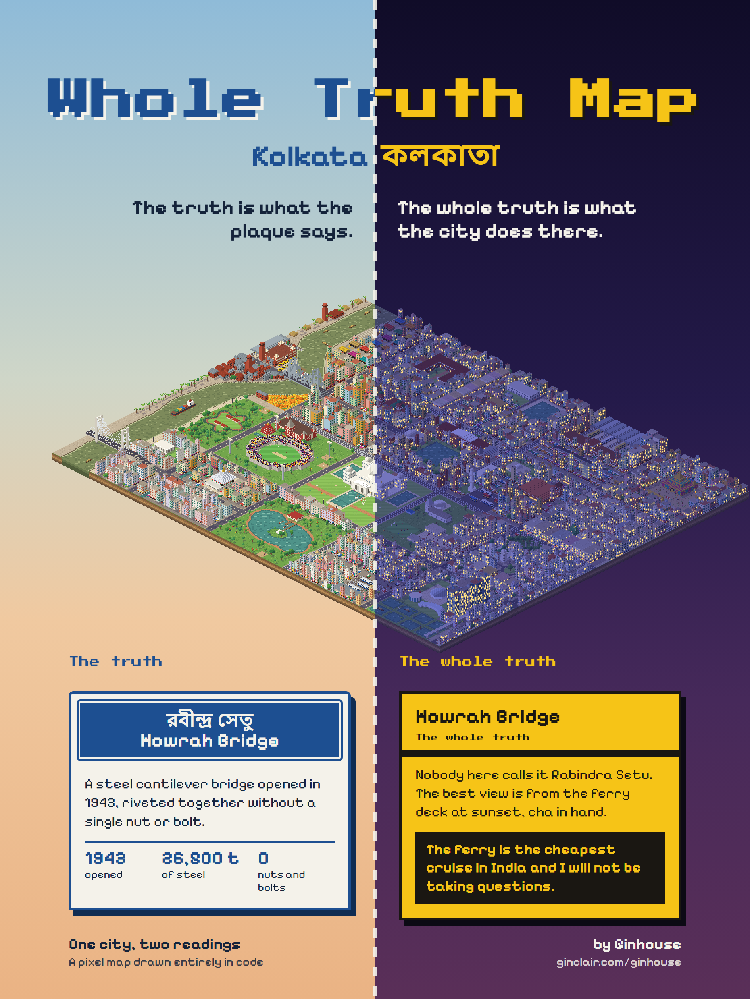

# Whole Truth Map: Kolkata

By [Ginhouse](https://ginclair.com/ginhouse).



A map that tells you the truth about a city, and then the whole truth. This first edition is Kolkata, drawn as a zoomable isometric pixel-art map. Every place carries two readings:

- **The truth** is the checkable part: dates, names, numbers.
- **The whole truth** is the lived part: what people do there, what is changing, how under-25s talk about it.

One switch flips the whole city from afternoon (truth) to dusk (whole truth) and flips each place card with it.

## Run it

No build step and no dependencies. Open `index.html` in a browser, or serve the folder:

```bash
npx serve .
```

Deploy by uploading the folder as-is to any static host (Vercel, Netlify, Cloudflare Pages, GitHub Pages).

## How it works

There are no image files. The city is drawn by code each time the page loads (about a second), into a colour buffer and a depth buffer. The depth buffer is what lets a moving tram pass behind a building.

| File | What it does |
|---|---|
| `js/engine.js` | Software isometric rasteriser: boxes, domes, trees, vehicles, ground shader, dusk tint |
| `js/layout.js` | Where the river, roads, bridges and flyovers are. Shared by the art and the animation |
| `js/city.js` | The 20 districts and their landmarks |
| `js/anim.js` | Moving layer: traffic, trams, ferries, birds, and the dusk-only lights and reaction icons |
| `js/data.js` | The places and all the copy |
| `js/app.js` | Pan and zoom, pins, card, search, share links |
| `css/style.css` | Interface. Truth is styled as a blue enamel street nameplate, the whole truth as a yellow-cab stencil |

## Edit the copy

All text lives in `js/data.js`. Each place has `truth` (a line plus fact chips) and `whole` (a line, a quote, three 1 to 5 meters, tags). Move a pin by changing `at: [i, j]`, the cell on the 120 x 96 grid.

Before publishing, have someone who knows the city check `js/data.js`. The truth lines are meant to be verifiable and should be verified. The whole-truth lines are opinion and will date quickly.

## Change the art

Edit a district in `js/city.js`, then preview without a browser:

```bash
node tools/render.js
```

This writes `tools/out/day.png` and `tools/out/night.png`. Pass `x y w h scale` to write a zoomed `crop.png`.

## Links

- `#/place/victoria` opens a place. Add `?m=whole` for the whole truth.
- `#x=860&y=520&z=2.0&m=truth` restores a view.

## Credits

Concept and production: Ginhouse, [ginclair.com/ginhouse](https://ginclair.com/ginhouse).

Inspired by Pixel Chennai (pixelchennai.com) by RC. No artwork from that project is used. Fonts: Pixelify Sans and Press Start 2P (SIL Open Font License), bundled in `fonts/`.
